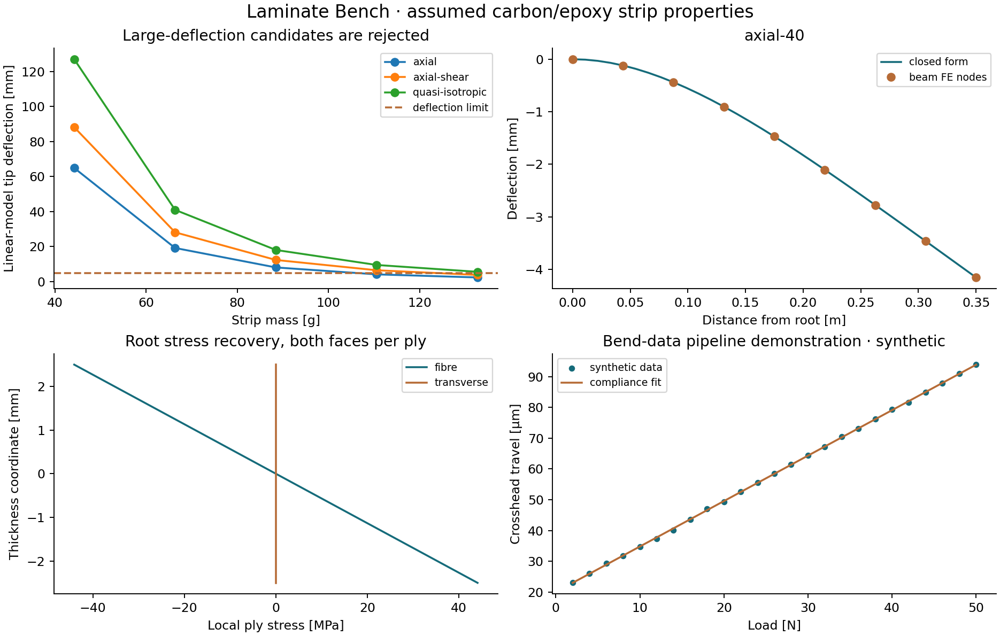

# Laminate Bench

Composite-strip sizing that connects a laminate calculation to a beam model and
a practical stiffness-test plan. It compares layup families, recovers ply-face
stresses and reduces three-point-bend data with machine-compliance correction.



For the assumed 350 × 40 mm cantilever at 120 N/m, the lightest passing
enumerated strip is **40 axial plies, 5.00 mm thick and 110.6 g**. Its predicted
tip deflection is **4.156 mm** against a 5 mm screen. This narrow load case
favours axial fibres; the [report](results/report.md) explains why that does
not make it a complete wing-spar design.

## Run it

Python 3.10+; NumPy for mechanics, Matplotlib for figures.

```sh
python3 -m venv .venv
. .venv/bin/activate
python -m pip install -r requirements-tested.txt
python -m pip install -e .
make test
make study
```

`python examples/study.py` also runs directly. Change dimensions, load,
limits or assumed material properties in [design.json](examples/design.json).

## Engineering path

1. Assemble A, B and D matrices from bottom-to-top ply angles and thickness.
   Solve the coupled six-component compliance problem; recover stresses at both
   faces of each ply, including tension/compression-specific strengths.
2. Convert the free-resultant bending compliance to strip EI. Compare symmetric
   axial, axial/shear and quasi-isotropic families on mass, deflection and a
   maximum-stress screen.
3. Solve a two-node Euler–Bernoulli beam FE model with consistent distributed
   loads and off-node point loads. Check deflection and reactions against closed
   forms before using the result.
4. Fit compliance from a declared elastic loading window. Subtract independently
   known machine compliance, retain the seating intercept and report fit residuals.

The checked-in data demonstration is **synthetic**, including its noise. It
verifies the reduction pipeline and is not evidence of fabricated coupons.
[Equations and assumptions](docs/mechanics.md); [test plan](docs/test-plan.md).

## Fixture concept


[OpenSCAD source](cad/bend_fixture.scad) models the base, supports, rollers and
coupon envelope for a 120 mm support span. The upper roller is an interface to
a test-frame crosshead. The concept has no established load rating, assembly
tolerances or manufactured parts.

## Scope

Material constants are illustrative carbon/epoxy inputs, not supplier-certified
or measured design allowables. The 1D model omits transverse shear deformation,
local buckling, joints, interlaminar stress, delamination, impact, fatigue and
environmental degradation. Maximum stress is a screening criterion; no
progressive damage or composite certification claim is made.

Source hashes and local tool versions accompany the checked-in [results](results/provenance.json).

MIT licensed. [Technical review](docs/review.md).
