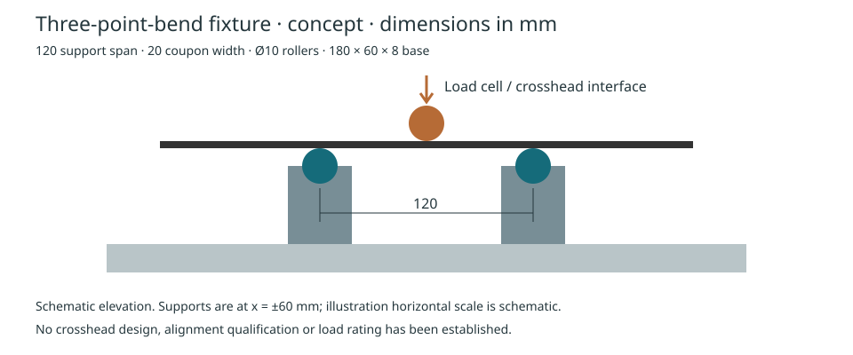

# Laminate Bench

A small composite-strip calculation with enough detail to compare it against a
bend test: laminate ABD matrices, a beam finite-element solution, ply-face stress
recovery and a compliance fit that accounts for the test frame.

The example is a 350 × 40 mm cantilever under 120 N/m. These are representative
candidates from the assumed carbon/epoxy study:

| Layup family | Plies / thickness | Mass | Tip deflection | 5 mm screen |
| --- | --- | ---: | ---: | --- |
| Axial | 40 / 5 mm | 110.6 g | 4.16 mm | Pass |
| Axial/shear | 48 / 6 mm | 132.7 g | 3.83 mm | Pass |
| Quasi-isotropic | 48 / 6 mm | 132.7 g | 5.62 mm | Fail |


The axial stack wins this bending-only case. The calculation does not include
shear webs, joints, torsion or impact loads. [Full results](results/report.md)
retain all 15 candidates and flag those outside the small-deflection assumptions.

## Run the sizing study

```sh
python3 -m venv .venv
. .venv/bin/activate
python -m pip install -r requirements-tested.txt
python -m pip install -e .
make test
make study
```

Python 3.10+ is supported. Edit [design.json](examples/design.json) for geometry,
load, limits and material inputs. All material constants are assumptions; they
are not batch measurements or design allowables.

EI comes from the full laminate compliance, including extension–bending coupling.
The beam tests check closed-form deflections and reactions. The bend-data example
fits a seating offset and subtracts independently supplied machine compliance.
Its data and noise are explicitly synthetic.

## Bend-fixture concept



The [OpenSCAD model](cad/bend_fixture.scad) uses a 120 mm support span, 10 mm
rollers and a 20 mm wide coupon. The study updates the coupon thickness in
[dimensions.scad](cad/dimensions.scad). GitHub CI parses the model and retains
the CSG output. Load-path detailing, tolerances and physical testing remain open.

The [test plan](docs/test-plan.md) covers specimen records, seating, frame
compliance and displacement resolution. The current example has only tens of
micrometres of travel, so instrumentation choice matters.

[Mechanics](docs/mechanics.md) · [Design notes](docs/review.md) ·
[Source hashes](results/provenance.json)
